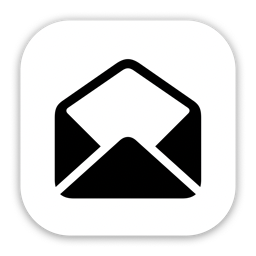

<p align="center">
  
  <h1 align="center">MessAuto</h1>
  <h4 align="center"> 自动提取Mac平台的短信和邮箱验证码</h4>
  <h4 align="center"> Automatic extraction 2FA code for Mac platform</h4>
<p align="center">
<a href="https://github.com/LeeeSe/MessAuto/blob/master/LICENSE.txt">
</a>
<a href="https://github.com/LeeeSe/MessAuto/releases">
</a>
<a href="https://img.shields.io/badge/-macOS-black?&logo=apple&logoColor=white">
</a>
</p>

<p align="center">
  [<a href="../README.md">English</a>] [<a href="./README-CN.md">中文</a>]<br>
</p>

# MessAuto

MessAuto 是一款 macOS 平台自动提取短信和邮箱验证码的软件，由 Rust 开发，适用于任何 App

支持带 Token 鉴权的 HTTP Webhook 和内嵌 ngrok 隧道，Android 短信转发 App 也能将验证码发送到 Mac。

下面展示了在 MessAuto 的辅助下完成短信登录的过程

https://github.com/LeeeSe/MessAuto/assets/44465325/6e0aca37-377f-463b-b27e-a12ff8c1e70b

🎉🎉🎉 MessAuto 现在支持邮件 App

https://github.com/LeeeSe/MessAuto/assets/44465325/33dcec87-61c4-4510-a87c-ef43e69c4e9d

## 使用方法
### 下载并安装
从 release [下载](https://github.com/LeeeSe/MessAuto/releases/latest)
### 授权
- 完全磁盘访问权限：设置 -> 隐私与安全性 -> 完全磁盘访问权限
- 辅助功能权限：设置 -> 隐私与安全性 -> 辅助功能权限
### 将信息和邮件 App 常驻后台
常驻后台可以缩短消息从 iPhone 同步到 Mac 所花时间

## 配置说明
- 自动粘贴：将剪贴板中的验证码模拟键盘自动粘贴到输入框内
- 自动回车：在自动粘贴验证码后再帮你按下回车键
- 不占用剪贴板： MessAuto 会模拟键盘直接输入验证码，不再占用剪贴板
- 监听短信：开启后将同时监听 Mac 自带的信息客户端（App 常驻后台效果最好，否则会延迟响应，非 MessAuto 的问题）
- 监听邮件：开启后将同时监听 Mac 自带的邮件客户端（同上）
- 隐藏图标：暂时隐藏菜单栏图标，App 重启后将再次显示（可用活动监视器 kill 掉）
- 配置：快速打开 TOML 格式的配置文件，可自定义正则及关键词
- 日志：快速打开日志
- 悬浮窗：获得验证码时自动在光标周围弹窗，将强制设定为 "不占用剪贴板" 状态

> 关键词: 也叫触发词，当信息中包含如"验证码"等关键词时，程序才会执行一系列后续操作，否则会忽略此条信息

## Webhook 与内嵌 ngrok

Webhook 默认监听 `0.0.0.0:8978`。向 `/webhook`（或 `/`）发送 POST，把短信全文放在 `value` 字段。它与短信、邮件共用现有解析器及浮窗、直接输入、剪贴板、粘贴、回车设置。

首次启动会自动生成 Webhook Token，可从托盘 **Webhook** 子菜单复制：

```bash
TOKEN='<你的 Webhook Token>'
curl -X POST 'http://127.0.0.1:8978/webhook' \
  -H "Authorization: Bearer $TOKEN" \
  -H 'Content-Type: application/json' \
  -d '{"value":"【知乎】你的验证码是 131964，此验证码用于登录知乎。"}'

# 也支持在 URL 中传递 token：
curl -X POST "http://127.0.0.1:8978/webhook?token=$TOKEN" \
  -H 'Content-Type: application/json' \
  -d '{"value":"【知乎】你的验证码是 131964，此验证码用于登录知乎。"}'
```

命中返回 `{"ok":true,"code":"131964"}`，并异步执行当前配置的动作。未找到验证码返回 HTTP 200、`ok:false`；JSON 非法或缺少 `value` 返回 400；Token 缺失或不正确返回 401。Authorization Header 优先于 Query Token。

托盘子菜单支持启停 Webhook / ngrok、查看运行状态、复制含 Token 的公网 / 局域网地址、复制 / 重新生成 Webhook Token，以及用隐藏输入框设置 ngrok authtoken。重新生成后，旧转发地址会失效。局域网地址依次从 `en0`、`en1` 获取。

ngrok 通过 Rust SDK 内嵌运行，无需安装 CLI。Webhook 运行时默认启用隧道。未配置 authtoken 时，会尝试从 `~/Library/Application Support/ngrok/ngrok.yml`、`~/.config/ngrok/ngrok.yml` 自动导入；也可点击 **设置 ngrok Token…**。连接前，请在 `config.toml` 中将 `ngrok_domain` 填为账号已有的 dev 域名。留空时托盘和通知会提示填写，本地 Webhook 仍可使用。免费账号不能将 SDK 随机分配的临时地址固定复用。

**连接前请先退出占用同一域名的外部 ngrok CLI。** 遇到冲突时 MessAuto 会通知，不会结束其他进程。关闭 ngrok 不影响本地 Webhook。

配置位于 `~/Library/Application Support/messauto/config.toml`：

```toml
listen_webhook = true
webhook_host = "0.0.0.0"
webhook_port = 8978
webhook_token = "<自动生成的 Token>"
ngrok_enabled = true
ngrok_authtoken = "<ngrok 账号 authtoken>"
ngrok_domain = "<账号分配的固定域名>.ngrok-free.dev"
version = 2
```

升级到配置版本 2 时会保留原有设置。修改域名后关闭再开启 ngrok；修改监听地址或端口后重启 MessAuto。

请妥善保管 Token 和包含 Token 的地址。ngrok authtoken 明文保存在配置文件中。公网 ngrok 地址使用 HTTPS，本地 HTTP 不加密，请在可信局域网使用。条件允许时优先使用 Bearer Header，避免 Token 留在 URL 历史或日志中。通过鉴权的请求会按当前设置触发键盘输入等动作。

## 常见问题
### 无法打开，因为无法验证开发者
两种解决方案，推荐第二种
- 打开访达并找到 MessAuto.app，右键打开
- 终端执行 `sudo spctl --master-disable`；设置->隐私与安全性->允许以下来源的应用程序->任何来源

### 辅助功能已经开启，但仍无法输入
旧授权记录可能仍绑定先前构建的代码签名。本次本机实测中就出现过开关已打开、TCC 日志却提示代码身份不匹配的情况。

先退出 MessAuto，移除它的旧辅助功能记录（或执行下方仅针对本 App 的重置命令），在「系统设置 → 隐私与安全性 → 辅助功能」中重新添加 `/Applications/MessAuto.app`、开启权限，再启动 App：

```bash
tccutil reset Accessibility com.leeese.messauto
```

「完全磁盘访问权限」用于读取短信和邮件，「辅助功能」用于模拟键盘，两者需要分别授予。系统提示「退出并重新打开」时，请确保重新打开的是 `/Applications` 中的当前版本。

### Webhook 无法监听 8978 端口
退出占用同一端口的其他程序（例如 AutoCode），或修改 `config.toml` 中的 `webhook_port` 后重启 MessAuto。

## TODO

- [x] 添加应用内更新
- [x] 优化验证码提取逻辑
- [ ] 发布到 Homebrew
- [ ] 支持第三方邮件客户端
- [ ] 支持 Android 和 Windows

## 开发

更新检查使用官方 `cargo-packager-updater` 0.2.3。如需代理，请在启动 MessAuto 前设置 `HTTP_PROXY`、`HTTPS_PROXY` 或 `ALL_PROXY` 环境变量；不再使用原自定义 fork 中读取 macOS 系统代理设置的接口。

```bash
# 下载源码
git clone https://github.com/LeeeSe/MessAuto.git
cd MessAuto

# 编译运行（非必需，仅用于开发测试）
cargo run

# 安装 cargo-packager
cargo install cargo-packager --locked
# 编译
cargo build --release
# 打包应用
cargo packager --release
```

生成的 MessAuto 应用位于 `target/release/MessAuto.app`。

## 感谢

- 感谢 [@尚善若拙](https://sspai.com/post/73072) 提供获取短信思路
